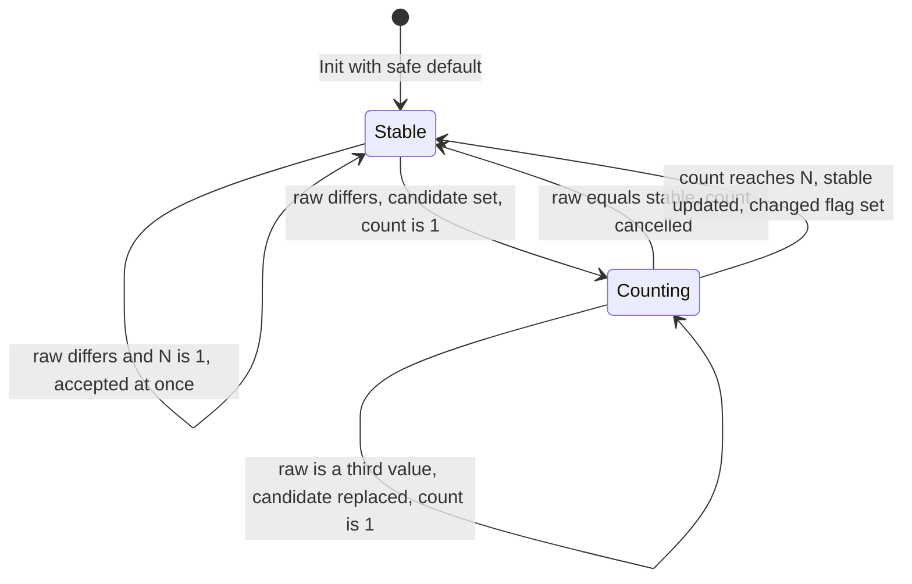
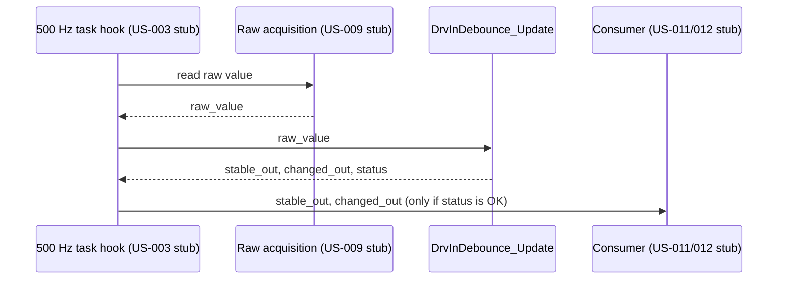

# US-010: Driver Input Filtering and Debounce - Design

## 1. Header

| Field | Value |
|---|---|
| Story ID | US-010 |
| Title | Driver input filtering and debounce |
| Jira | [WIPC-7](https://karthikeyanaitrainings.atlassian.net/browse/WIPC-7) |
| Size | S |
| Review gate | Standard (per backlog Review column). No ASIL is assumed; see OQ-US010-06. |
| Document status | Draft (re-verified 2026-10-27) |
| Date | 2026-10-27 |
| Author | AI-assisted, pending human review |

Sources: [PRD v1.0](../wiper_control_system_product_requirements.md), [user stories backlog](../wiper_control_system_user_stories.md), [AGENTS.md](../../AGENTS.md).

Everything below is a proposal pending human review. Nothing here claims compliance or verified results.

**Re-verification note (2026-10-27):** This document was re-checked against the PRD and against Jira search results for WIPC-7 in this session. Jira tool access this session was limited to semantic search (read-only snippets); no `getJiraIssue`, transition, comment, or assignment tools were available. The search confirmed: issue title, `Traces to: PR-007`, `Size / Review: S / Standard`, and `Depends on: None (standalone; ... no dependency on the HAL input module US-009)` — all consistent with this document's existing content and with OQ-US010-03 below. Current Jira status, assignee, labels, and comment history could not be independently reconfirmed this session; no start-of-work (assign/transition) or end-of-work (comment) Jira updates were made. See Section 8 for the recommendation to perform these manually or re-run with full Jira tool access.

## 2. Story summary

Source: Jira WIPC-7 (backlog entry US-010).

**Story:** As a driver, I want switch noise ignored without noticeable delay, so that the wipers respond reliably.

**Acceptance criteria (verbatim from Jira):**

- AC-1: Debounce time is a configuration parameter (`TBD` ms) derived from input hardware; tests use a clearly marked test value.
- AC-2: A bounce shorter than the debounce time never changes the output.
- AC-3: A valid change is reported within the response-time budget.
- AC-4: C99, MISRA C:2012 compliant, fixed-width types, no dynamic allocation, no blocking calls, bounded execution time.

**Independent test:** Feed bounce patterns and clean transitions on a simulated clock; check output edges and latency.

**Scope note (Jira):** Pure C logic module with host-based unit tests in `tests/unit/`; no hardware or neighbouring story required. Takes plain value + tick inputs.

**Jira open question:** Response-time requirement for driver commands is not specified in the PRD; request a value.

## 3. Requirements analysis

### 3.1 Traced PRD requirements

| ID | PRD text (summary) | How this story satisfies it |
|---|---|---|
| PR-007 | The system shall apply input filtering/debounce appropriate to the selected input hardware without violating response-time requirements. Verification: Test. | Per-input debounce module with a hardware-derived `TBD` time (AC-1), no output change on shorter bounces (AC-2), and bounded added latency (AC-3). The response-time requirement itself is not in the PRD (OQ-US010-01). |

Related but not owned by this story (interfaces only): PR-006 (invalid/noisy/unavailable inputs, US-011), PR-001 to PR-004 (modes, US-012/013), PR-005 (OFF priority, US-014), PR-020 (2 ms task period, US-003).

Facts used from AGENTS.md: 500 Hz / 2 ms control task (PR-020); MISRA C:2012; C99 (demo default); no dynamic allocation, no recursion, no unbounded loops in the control path; MCU-specific code only behind `src/hal/`.

### 3.2 Derived requirements (all proposed)

None of these is a safety or security requirement; they are design-level, so no SR/SEC IDs are proposed. IDs use the `DR-010-nn` form.

| ID | Statement | Rationale | Source |
|---|---|---|---|
| DR-010-01 | The module shall be hardware-independent pure C with no HAL, clock, or global-state access; inputs are a raw value and a tick call. | Jira scope note; AGENTS.md Section 16 (host-testable logic). | Jira, AGENTS.md 4 |
| DR-010-02 | The debounce threshold shall be held in whole control ticks, converted from milliseconds with round-up: `ticks = ceil(debounce_ms / tick_period_ms)`. | Jira "plain value + tick inputs"; round-up guarantees the debounced time is not shorter than configured, so AC-2 holds. | AC-1, AC-2 |
| DR-010-03 | The output shall change only after the same new raw value has been observed on N consecutive ticks (N = threshold ticks). | Implements AC-2: a bounce shorter than the debounce time cannot reach N. | AC-2, PR-007 |
| DR-010-04 | Any sample that differs from the current candidate shall restart the count (for the new candidate) or cancel it (if equal to the current stable value). | Defines behavior for multi-position inputs and multiple bounces. | AC-2 |
| DR-010-05 | A change shall be reported on exactly the tick on which the stable output changes, via a one-shot `changed` flag. | Lets consumers latch edges; makes latency measurable (AC-3). | AC-3 |
| DR-010-06 | After init, the output shall equal a caller-supplied safe default value until a raw value is confirmed for N ticks. | Conservative: avoids accepting an unverified first sample at startup (see PR-063, US-007). Adds N ticks of startup latency. | Assumption A-04 |
| DR-010-07 | Configuration shall be validated at init: `tick_period_ms > 0`, `debounce_ms > 0`, computed ticks in [1, `UINT16_MAX`], and no integer overflow in the conversion. Invalid configuration returns an error and leaves the instance uninitialised. | AGENTS.md 4 (validate inputs at module boundaries). | AGENTS.md 4 |
| DR-010-08 | `Update` shall return an error status, without writing outputs, for NULL pointers, an uninitialised instance, or corrupted instance state (threshold < 1 or count > threshold). | No silent failures; cheap RAM-corruption guard. | AGENTS.md 4 |
| DR-010-09 | Per-call execution shall be O(1): no loops, no recursion, no dynamic allocation, no blocking calls; storage is caller-provided; the counter saturates at the threshold and cannot overflow. | AC-4; AGENTS.md 4 and 5. | AC-4 |
| DR-010-10 | The raw value shall be treated as an opaque `uint8_t` code compared only for equality. The module shall not interpret the encoding or the validity of a value. | Switch encoding is undefined (PRD OQ-6); validity belongs to US-011. | PRD OQ-6, US-011 |

### 3.3 Acceptance criteria mapping

| AC | Requirements | Tests (Section 6) |
|---|---|---|
| AC-1 | PR-007, DR-010-02, DR-010-07 | T-04, T-05, T-06 |
| AC-2 | PR-007, DR-010-03, DR-010-04 | T-02, T-03, T-07, T-08, T-12 |
| AC-3 | PR-007, DR-010-02, DR-010-05, DR-010-06 | T-01, T-09, T-10 |
| AC-4 | DR-010-01, DR-010-09, DR-010-10 | T-11, T-13, T-14, T-15, T-16 |

### 3.4 Assumptions (not requirements)

| ID | Assumption |
|---|---|
| A-01 | `Update` is called once per input per 500 Hz control tick, so one tick equals 2 ms (PR-020 facts: 2 ms period; call placement is US-003's hook order). |
| A-02 | Debounce is symmetric (same time for either direction of change). Asymmetric times are a future extension if hardware needs it (OQ-US010-09). |
| A-03 | Debounce time is chosen per input; the number of inputs and their encoding are unknown (PRD OQ-6). |
| A-04 | The caller supplies a safe default (for example the OFF code) at init; the module does not decide what is safe. |
| A-05 | The module is placed in `src/drivers/` (see 4.1); Jira allows `src/control/` or `src/drivers/`. |

### 3.5 Out of scope

- Reading the hardware switch (US-009).
- Validity, contradiction, stuck, or missing-signal detection and fault events (US-011, US-042).
- Mode logic, intermittent timing, arbitration (US-012 to US-014).
- Choosing the real debounce time, response-time budget, or switch encoding (hardware and system data, OQ-US010-01/02).
- Source code, tests, and build changes (this document only).

## 4. Design

### 4.1 Module placement

| Item | Location (planned) | Responsibility |
|---|---|---|
| Public header | `include/driver_input_debounce.h` | Types, status codes, function prototypes |
| Implementation | `src/drivers/driver_input_debounce.c` | Per-instance debounce state machine; no HAL includes |
| Config constants | `src/config/` (names below) | Per-input debounce ms, tick period ms |
| Unit tests | `tests/unit/test_driver_input_debounce.c` | Host tests, no mocks needed beyond the caller's loop |

The module is HAL-free, so it sits in `src/drivers/` only for logical grouping with input acquisition; it needs no `src/hal/` code. Moving it to `src/control/` changes nothing else (OQ-US010-07).

### 4.2 Interfaces

Names are proposed. Types are fixed-width. Ownership: the caller owns all instances (static storage); the module holds no pointers after a call returns.

```c
typedef uint8_t DrvIn_Value_t;   /* opaque encoded position; encoding TBD (PRD OQ-6) */

typedef enum {
    DRVIN_DEB_OK = 0,
    DRVIN_DEB_ERR_NULL_PTR,
    DRVIN_DEB_ERR_BAD_CONFIG,
    DRVIN_DEB_ERR_NOT_INIT,
    DRVIN_DEB_ERR_STATE
} DrvInDebounce_Status_t;

typedef struct {
    DrvIn_Value_t stable_value;     /* current debounced output */
    DrvIn_Value_t candidate_value;  /* value being counted */
    uint16_t      count_ticks;      /* consecutive ticks of candidate, 0..threshold_ticks */
    uint16_t      threshold_ticks;  /* N, 1..UINT16_MAX */
    bool          initialised;
} DrvInDebounce_t;

DrvInDebounce_Status_t DrvInDebounce_Init(DrvInDebounce_t *inst,
                                          DrvIn_Value_t safe_default,
                                          uint32_t debounce_ms,
                                          uint32_t tick_period_ms);

DrvInDebounce_Status_t DrvInDebounce_Update(DrvInDebounce_t *inst,
                                            DrvIn_Value_t raw_value,
                                            DrvIn_Value_t *stable_out,
                                            bool *changed_out);
```

| Function | Inputs and units | Outputs | Call order |
|---|---|---|---|
| `DrvInDebounce_Init` | `debounce_ms`, `tick_period_ms` in ms; `safe_default` opaque code | Instance initialised, or status error | Once at startup, before first `Update`; may be re-called to reset |
| `DrvInDebounce_Update` | `raw_value` opaque code sampled this tick | `*stable_out` current debounced value; `*changed_out` true only on the tick the value changed | Once per input per control tick, after the raw sample is available (US-009 stub) and before consumers (US-011/012) |

Interfaces to other stories (all via stubs for this story):

| Neighbour | Direction | Detail |
|---|---|---|
| US-009 (raw acquisition) | Feeds `raw_value` | Not a hard dependency in Jira; the caller passes a plain value. Availability flag is not consumed here (OQ-US010-04). |
| US-011 (validity) | Consumes `stable_out` | Applies validity and contradiction checks to debounced values (backlog order). |
| US-012 (mode manager) | Consumes `stable_out`/`changed_out` | Uses validated input only. |
| US-003 (scheduler) | Provides tick | Supplies `tick_period_ms` constant and hook order; stubbed by the unit-test loop. |

### 4.3 Data and configuration

| Parameter | Value | Source / owner | Notes |
|---|---|---|---|
| `DRVIN_DEBOUNCE_MS[input]` | `TBD` | Input hardware datasheet / switch supplier (OQ-US010-02) | Per input; AC-1. |
| `CTRL_TASK_PERIOD_MS` | 2 | PR-020 (2 ms period); final constant owned by US-003 | Must not be a literal in logic (US-003 AC). |
| Debounce time used in tests | TEST-ONLY, chosen in test code and labelled as such | Test author | Not a requirement and not a hardware value. |
| Maximum debounce ticks | 65535 (type limit of `uint16_t`) | Design choice | An engineering upper bound tied to the response-time budget is `TBD` (OQ-US010-01). |
| `debounce_ticks` | `ceil(debounce_ms / CTRL_TASK_PERIOD_MS)` | Derived (DR-010-02) | Computed at init, not per tick. |

Memory estimate (not measured): about 8 bytes RAM per input (1+1+2+2+1 payload, plus alignment), number of inputs `TBD` (PRD OQ-6). Flash: `TBD`, small; to be reported against the US-002 budget. No heap, no persistent storage.

### 4.4 Behavior

Per-update steps (DR-010-03/04/05/09). Let `N = threshold_ticks`.

1. Validate pointers, `initialised`, and state invariants; on failure return an error status and write no outputs.
2. If `raw_value == stable_value`: set `candidate_value = stable_value`, `count_ticks = 0`, `changed = false`.
3. Else if `raw_value == candidate_value` and `count_ticks > 0`: increment `count_ticks` (never above `N`).
4. Else: set `candidate_value = raw_value`, `count_ticks = 1`.
5. If `count_ticks >= N` after step 3 or 4: set `stable_value = candidate_value`, `count_ticks = 0`, `changed = true`; otherwise `changed = false`.
6. Write `*stable_out = stable_value` and `*changed_out = changed`.





Latency (AC-3): a valid change held for N consecutive ticks is reported on the Nth tick after it first appears, i.e. up to `N x tick_period_ms` after the edge (plus task jitter and sampling phase). If a consumer is scheduled before the debouncer in the same cycle, add one tick (2 ms, from the PR-020 period). Because of round-up, the added latency can exceed the configured `debounce_ms` by up to one tick. Comparison with the response-time budget is blocked by OQ-US010-01.

Rotary or multi-position input: while the dial moves through intermediate positions, each new value restarts the count, so a settled position is reported N ticks after the last movement. This is deliberate (DR-010-04) and is a conservative reading; confirm it is acceptable for the intermittent dial (US-013).

Execution context and timing: runs in the 500 Hz control task, once per input per tick. O(1), no loops, no blocking (DR-010-09). WCET impact on the 2 ms task (limit 1.5 ms, demo default): `TBD`, to be measured on target and included in US-008; expected to be a few comparisons per input, but no number is claimed.

### 4.5 Error handling

| Input / condition | Validation | Defined behavior | Negative test |
|---|---|---|---|
| `inst`, `stable_out`, or `changed_out` is NULL | Pointer check | `DRVIN_DEB_ERR_NULL_PTR`; no outputs written | T-13 |
| `Update` before successful `Init` | `initialised` flag | `DRVIN_DEB_ERR_NOT_INIT`; no outputs written | T-13 |
| `debounce_ms == 0` or `tick_period_ms == 0` | Range check | `DRVIN_DEB_ERR_BAD_CONFIG`; instance not initialised | T-14 |
| Computed ticks exceed `UINT16_MAX` or conversion would overflow `uint32_t` | Checked arithmetic (no wrap) | `DRVIN_DEB_ERR_BAD_CONFIG` | T-14 |
| Instance state corrupted (`threshold_ticks == 0` or `count_ticks > threshold_ticks`) | Invariant check each call | `DRVIN_DEB_ERR_STATE`; no outputs written; caller reports a fault (US-042) | T-13 |
| `raw_value` is an unknown or invalid code | None possible here (DR-010-10) | Treated as a normal value and debounced; US-011 rejects it downstream | T-12 |
| Raw signal unavailable | Not an input to this module | Caller must not call `Update` with a fabricated value; handling is US-011's (OQ-US010-04) | N/A, covered by US-011 |
| Caller ignores error status | Out of module control | Caller's duty; a defined safe response (hold output, raise fault) is for US-011/US-042 integration | Integration, later |

Fault reporting path: the module only returns status; fault catalog entries and recording are owned by US-041/US-042 and are not created here.

## 5. Safety and security considerations

Standard gate: N/A for formal safety analysis, with these notes.

- Hazards touched: debounce delay on the OFF position adds to the time between the driver commanding OFF and the system seeing it (relates to PR-005 and unintended wiping). Whether OFF needs a shorter or no debounce is for the HARA (OQ-US010-06); no ASIL is assumed. If the HARA allocates a safety goal, this gate is to be raised to Safety.
- Failure of the module (stuck state, corrupted RAM) could hold a stale mode; mitigation here is the invariant check (DR-010-08); mitigations at system level belong to US-011 and US-043.
- Freedom from interference: no shared mutable state, no globals; each instance is caller-owned and used from one context (the 500 Hz task). Not safe for concurrent use from another context; this is a documented constraint.
- Trust boundaries / security: input arrives from the HAL or, if the driver input is on the vehicle network, from that network (PRD OQ-10). Authenticity and bound-checking of network input are outside this module. No SEC requirement is proposed. No keys, crypto, or secrets are involved.

## 6. Verification plan

All tests are host-based unit tests, using a simulated tick counter (one `Update` call equals one tick). Values for N and `debounce_ms` in tests are test-only. Where a test names N, it means the test-chosen threshold.

| Test ID | Type | Covers | Method | Expected result |
|---|---|---|---|---|
| T-01 | Unit | AC-3, DR-010-05 | Clean step from stable A to B, hold B | `changed` false for ticks 1 to N-1, true exactly on tick N; `stable_out` becomes B on tick N |
| T-02 | Boundary | AC-2, DR-010-03 | For each k from 1 to N-1: B for k ticks, then back to A | `stable_out` stays A, `changed` never true |
| T-03 | Unit | AC-2, DR-010-04 | Alternate A,B every tick for many ticks | No change ever reported |
| T-04 | Unit | AC-1, DR-010-02 | Several `(debounce_ms, tick_period_ms)` pairs (exact multiple, non-multiple, 1 ms, equal to period) | Threshold ticks equal the ceil values (for example 10/2 -> 5, 11/2 -> 6, 1/2 -> 1) |
| T-05 | Boundary | AC-1, DR-010-07 | Minimum config (1 tick) and maximum (`UINT16_MAX` ticks) | Init OK; behavior matches T-01 for both (1-tick: accepted on first differing sample) |
| T-06 | Unit | AC-1 | Build with the project's TEST-ONLY debounce constant | Test value is visibly labelled; no production constant is used by tests |
| T-07 | Unit | AC-2, DR-010-04 | B for N-1 ticks, one A, then B held | Change reported N ticks after the A, not earlier |
| T-08 | Unit | AC-2, DR-010-04 | Three-value sequence: B for k < N ticks, then C held N ticks | Output goes A to C directly; B never appears on `stable_out` |
| T-09 | Unit | AC-3 | Measure ticks from first differing sample to `changed` for several N | Latency equals N ticks; asserted against a TEST-ONLY budget value (real budget `TBD`, OQ-US010-01) |
| T-10 | Unit | AC-3, DR-010-06 | Init with safe default D; feed D, then X held | Output is D until X held N ticks; no change while raw equals D |
| T-11 | Unit | DR-010-05 | After an accepted change, hold the new value for many ticks | `changed` true only once |
| T-12 | Unit | AC-2, DR-010-10 | Feed arbitrary byte codes (0 to 255 sweep, each held N ticks) | Every code is accepted after N ticks and none is rejected or reinterpreted by the module |
| T-13 | Fault injection | DR-010-08, DR-010-09 | NULL `inst`, NULL out pointers, `Update` before `Init`, corrupted `threshold_ticks == 0`, corrupted `count_ticks > threshold_ticks` | Correct error status each time; output variables untouched |
| T-14 | Fault injection | DR-010-07 | `debounce_ms = 0`, `tick_period_ms = 0`, ticks above `UINT16_MAX`, `UINT32_MAX` inputs | `DRVIN_DEB_ERR_BAD_CONFIG`; instance not initialised; `Update` then returns `ERR_NOT_INIT` |
| T-15 | Unit | DR-010-09 | 70000+ ticks of sustained alternating and sustained differing input at max threshold | Counter never exceeds threshold; no wrap or false change |
| T-16 | Static analysis / review | AC-4, DR-010-01, DR-010-09 | Cppcheck MISRA add-on and clang-tidy (project tools, versions `TBD`) with warnings as errors; review for no heap, no loops, no recursion, no HAL includes | No unresolved findings; any deviation has a recorded record |
| T-17 | Unit | A-03 | Two or more instances updated in the same loop with different inputs | Instances are independent |
| T-18 | Timing | AC-4 | On-target WCET of `Update` per input in the 500 Hz task | `TBD`; result recorded in US-008 inputs. Not runnable on host |

## 7. Traceability matrix

| Requirement | Design element | Planned code location | Test IDs |
|---|---|---|---|
| PR-007 | Debounce state machine (4.4), config (4.3) | `src/drivers/driver_input_debounce.c` | T-01, T-02, T-03, T-09 |
| DR-010-01 (US-010/AC-4) | HAL-free module (4.1) | `src/drivers/driver_input_debounce.c`, `include/driver_input_debounce.h` | T-16 |
| DR-010-02 (AC-1) | Ms-to-tick conversion in `Init` | `DrvInDebounce_Init` | T-04, T-05, T-06 |
| DR-010-03 (AC-2) | N-consecutive-tick rule | `DrvInDebounce_Update` | T-01, T-02, T-03 |
| DR-010-04 (AC-2) | Candidate restart / cancel | `DrvInDebounce_Update` | T-03, T-07, T-08 |
| DR-010-05 (AC-3) | One-shot `changed` flag | `DrvInDebounce_Update` | T-01, T-11 |
| DR-010-06 (AC-3) | Safe-default init | `DrvInDebounce_Init` | T-10 |
| DR-010-07 (AC-1) | Config validation | `DrvInDebounce_Init` | T-05, T-14 |
| DR-010-08 | Pointer, init, invariant checks | `DrvInDebounce_Update` | T-13 |
| DR-010-09 (AC-4) | O(1), saturating counter, static storage | whole module | T-15, T-16, T-18 |
| DR-010-10 | Opaque equality compare | `DrvInDebounce_Update` | T-12 |
| US-010 AC-3 budget | Latency N ticks (4.4) | `DrvInDebounce_Update` | T-09 (test value only; real budget blocked by OQ-US010-01) |

Every requirement above has at least one test; every test (T-01 to T-18) appears in the matrix or Section 3.3 (T-17 covers A-03).

## 8. Dependencies and risks

| Item | Detail |
|---|---|
| Hard dependencies | None in Jira. The backlog lists US-009; Jira dropped it for demo scope (OQ-US010-03). |
| Stubs required | Tick caller (stands in for US-003 hook), raw value source (US-009), consumer (US-011/012). All are in the test loop. |
| Downstream | US-011 and US-012 consume `stable_out`; they depend on this interface, so keep the type and status names stable once reviewed. |
| Risk: undefined response budget | Cannot show AC-3 compliance against a real number until OQ-US010-01 is answered. |
| Risk: unknown hardware | If the real input is network-delivered, debounce may be unnecessary or differ; the design is cheap to adapt. |
| Risk: startup latency | DR-010-06 delays the first valid mode by N ticks; may conflict with a startup-response need (to be checked with US-007). |
| Risk: Jira state not reconfirmed | This session's Jira tool access was search-only; current WIPC-7 status, assignee, labels, and comments were not re-fetched, and no assign/transition/comment actions were performed. Perform these manually, or re-run this analysis with full Jira read/write tool access. |
| Recommended doc changes (not made here) | PRD: add a driver-command response-time requirement and, if applicable, an OFF-specific one. Backlog: reconcile US-010 "Depends on" (US-009 vs none) with Jira. |

## 9. Open questions and decisions

Blocking means it prevents implementation from starting.

| ID | Question | Impact | Owner | Blocking |
|---|---|---|---|---|
| OQ-US010-01 | What is the response-time requirement for driver commands (and for OFF specifically)? Not in the PRD; also needs an upper bound on debounce time. | AC-3 cannot be verified against a real value; max threshold unknown. | System architect / product owner | No (implementation). Yes for AC-3 sign-off. |
| OQ-US010-02 | What is the input hardware (switch type, contact bounce time) and the resulting debounce time per input? Relates to PRD OQ-6, OQ-10. | `DRVIN_DEBOUNCE_MS` stays `TBD`; if input arrives over the vehicle network, debounce may change or be dropped. | Hardware / supplier | No |
| OQ-US010-03 | Backlog US-010 depends on US-009; Jira says no dependency. Which is authoritative? Design follows Jira (plain value input). | Dependency lists and wave order in the backlog. | Product owner | No |
| OQ-US010-04 | Where does "signal unavailable" (US-009 value/available split) get handled relative to debounce? Design assumes the caller does not call `Update` for unavailable samples and US-011 owns the handling. | Possible gap or double handling between US-009, US-010, US-011. | Software lead | No |
| OQ-US010-05 | Is `CTRL_TASK_PERIOD_MS` provided by US-003 config? Until then, a local config constant is assumed. | Naming and include path. | Software lead | No |
| OQ-US010-06 | Should the OFF position be debounced the same as others, given PR-005 and the HARA (ASIL not allocated)? | May raise the review gate to Safety or change the OFF path. | Safety engineer | No |
| OQ-US010-07 | Place the module in `src/drivers/` (proposed) or `src/control/`? | File paths only. | Software lead | No |
| OQ-US010-08 | Is the startup behavior DR-010-06 (output = safe default for N ticks) acceptable, and what safe default code applies? | Startup latency and interplay with US-007. | Safety / software lead | No |
| OQ-US010-09 | Is symmetric debounce enough, or does the hardware need different press and release times? | Possible API extension. | Hardware | No |

Blocking: 0 of 9.

## 10. Review checklist

- [ ] Every acceptance criterion maps to at least one requirement and at least one test (Section 3.3).
- [ ] PR-007 text matches the PRD.
- [ ] All numeric values are sourced, `TBD`, or labelled TEST-ONLY / demo default.
- [ ] No ASIL, MCU part, or vehicle interface is assumed.
- [ ] Interfaces use fixed-width types, units, and ranges; no dynamic allocation, recursion, or unbounded loops.
- [ ] Every failure path has a defined behavior and a negative test (Section 4.5).
- [ ] Timing impact on the 2 ms task is stated (WCET `TBD`, T-18).
- [ ] Review gate (Standard) accepted, or raised to Safety per OQ-US010-06.
- [ ] Mermaid diagrams render and relative links resolve.
- [ ] Open questions OQ-US010-01 to 09 have owners.
