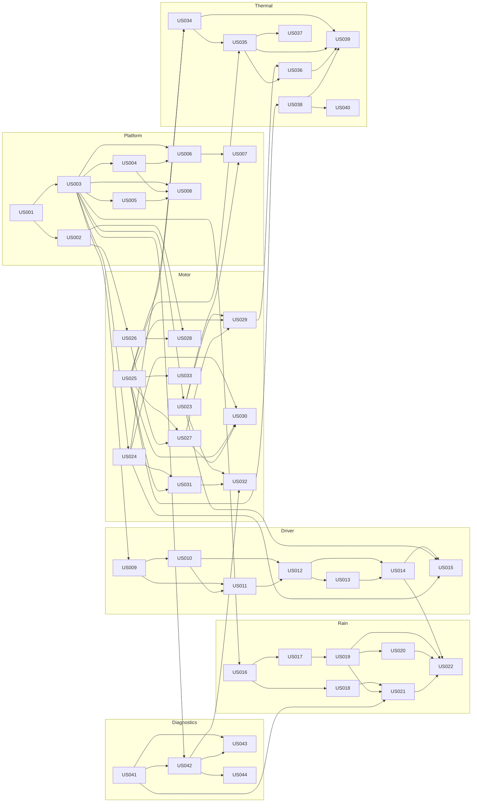

# User Stories: Rain-Adaptive Wiper Control System

**Source:** [Product Requirements Document v1.0](wiper_control_system_product_requirements.md)
**Purpose:** Backlog input for per-story requirement analysis.
**Status:** Draft for requirement analysis

## 1. Conventions

### 1.1 Story size (S / M / L)

Story size is unrelated to the Small/Medium/Large motor variants (PR-040). Motor variants are always written out in full ("Small motor variant").

| Size | Meaning |
|---|---|
| **S** | One module, one or two requirements, no unresolved external decision on the critical path. |
| **M** | One feature spanning a module plus its interface (HAL, calibration, or diagnostics), or one that needs a bounded external input. |
| **L** | Cross-module, safety-related, or blocked by several open decisions. Any story that would exceed L must be split. |

No story in this backlog is larger than M. Anything that grows beyond M during analysis shall be split before it enters a sprint.

### 1.2 Rules every story follows

- **Independently testable:** each story has an *Independent test* that runs on the host with HAL and driver mocks, without waiting for other stories. Neighbouring stories are replaced by stubs.
- **Dependencies are hard dependencies:** "Depends on" lists only stories that must be done before this one can be finished and verified. Stubbed neighbours are not listed.
- **Global enablers:** US-045 (host test harness / fault injection) and US-046 (traceability baseline) apply to every story and are not repeated in each dependency list.
- **No invented values:** thresholds, ratings, intervals, and limits are `TBD` until supplied by approved data (PRD Section 8). Demo defaults from AGENTS.md (LIN, 20 ms latency target, 25% timing margin, RH850) are marked as such.
- **Review gate:** *Safety* means the story touches motor limits, timing, or fault handling and needs safety review (AGENTS.md Sections 8 and 13). *Standard* means normal code review. No ASIL is assumed.
- **IDs:** `US-xxx` are story IDs. `PR-xxx` are PRD requirement IDs. `OQ-n` refers to PRD Section 12 open question n. `VV-xxx` are PRD Section 11 tests.

## 2. Story Index

| ID | Title | Epic | Size | Depends on | Traces to | Review |
|---|---|---|---|---|---|---|
| US-001 | MCU selection criteria and evaluation | Platform | M | None | PR-023, PR-024 | Standard |
| US-002 | RAM and flash budget | Platform | S | US-001 | PR-031 | Standard |
| US-003 | 500 Hz control task scheduling | Platform | M | US-001 | PR-020, PR-030 | Safety |
| US-004 | Task execution-time measurement and timing diagnostics | Platform | M | US-003 | PR-027 | Safety |
| US-005 | Background workload isolation | Platform | M | US-003 | PR-025, PR-030, PR-034 | Safety |
| US-006 | Watchdog supervision and overrun/lockup/reset behavior | Platform | M | US-003, US-004 | PR-026 | Safety |
| US-007 | No unintended motor activation at startup, reset, brownout | Platform | M | US-006, US-023 | PR-063 | Safety |
| US-008 | WCET analysis and timing-margin sign-off | Platform | M | US-003, US-004, US-005 | PR-021 | Safety |
| US-009 | Driver input signal acquisition | Driver Input | S | US-003 | PR-001 to PR-004 | Standard |
| US-010 | Driver input filtering and debounce | Driver Input | S | US-009 | PR-007 | Standard |
| US-011 | Driver input validity checking | Driver Input | M | US-009, US-010 | PR-006 | Safety |
| US-012 | OFF and ON/continuous modes | Driver Input | M | US-010, US-011 | PR-001, PR-002 | Standard |
| US-013 | Intermittent mode with configurable interval | Driver Input | M | US-012 | PR-003 | Standard |
| US-014 | Driver vs automatic priority arbitration | Driver Input | M | US-012, US-013 | PR-005 | Safety |
| US-015 | Safe park sequence on OFF | Driver Input | M | US-014, US-023, US-024 | PR-005 | Safety |
| US-016 | Rain-sensor data acquisition | Rain Sensing | M | US-003 | PR-010 | Standard |
| US-017 | Calibrated rain-intensity level estimation | Rain Sensing | M | US-016 | PR-010 | Standard |
| US-018 | Rain-sensor data validity detection | Rain Sensing | M | US-016 | PR-013 | Safety |
| US-019 | Rain intensity to wipe interval/speed mapping | Rain Sensing | M | US-017 | PR-011, PR-015 | Standard |
| US-020 | Mapping hysteresis, filtering, and transition behavior | Rain Sensing | M | US-019 | PR-012 | Standard |
| US-021 | Rain-sensor invalid fallback and driver indication | Rain Sensing | M | US-018, US-019, US-041 | PR-014 | Safety |
| US-022 | Automatic mode integration | Rain Sensing | M | US-014, US-019, US-020, US-021 | PR-004 | Standard |
| US-023 | Motor command generation through motor driver | Motor | M | US-003 | PR-022 | Safety |
| US-024 | Motor feedback acquisition | Motor | M | US-003 | PR-022 | Safety |
| US-025 | Motor variant parameter sets (Small/Medium/Large) | Motor | M | None | PR-040, PR-041 | Safety |
| US-026 | Persistent settings integrity, versioning, defaults | Motor | M | US-002 | PR-033 | Safety |
| US-027 | Startup motor-variant configuration validation | Motor | M | US-025, US-026 | PR-046 | Safety |
| US-028 | Memory exhaustion and corrupted-configuration handling | Motor | M | US-002, US-026 | PR-032 | Safety |
| US-029 | Speed and operating-envelope limiting | Motor | M | US-023, US-025, US-027 | PR-042, PR-043 | Safety |
| US-030 | Current and torque limit enforcement | Motor | M | US-024, US-025, US-027 | PR-042 | Safety |
| US-031 | Stall, overload, and abnormal-current detection | Motor | M | US-024, US-025 | PR-044 | Safety |
| US-032 | Protective response to overload/stall | Motor | M | US-023, US-031, US-042 | PR-045 | Safety |
| US-033 | Motor and linkage sizing verification | Motor | M | US-025 | PR-047 | Safety |
| US-034 | Motor/driver temperature monitoring or thermal model | Thermal | M | US-024, US-025 | PR-052 | Safety |
| US-035 | Thermal warning, derating, and shutdown thresholds | Thermal | M | US-025, US-034 | PR-054 | Safety |
| US-036 | Visibility-aware thermal response | Thermal | M | US-029, US-035 | PR-055 | Safety |
| US-037 | Thermal protection recovery | Thermal | S | US-035 | PR-056 | Safety |
| US-038 | Eight-hour duty-cycle policy definition | Thermal | M | US-025 | PR-050, PR-051 | Safety |
| US-039 | Eight-hour duty-cycle policy implementation | Thermal | M | US-034, US-035, US-036, US-038 | PR-050, PR-051 | Safety |
| US-040 | Thermal design and component-rating verification | Thermal | M | US-038 | PR-053 | Safety |
| US-041 | Fault catalog definition | Diagnostics | M | None | PR-061 | Safety |
| US-042 | Fault detection and recording framework | Diagnostics | M | US-003, US-041 | PR-060 | Safety |
| US-043 | Fallback state manager | Diagnostics | M | US-041, US-042 | PR-062 | Safety |
| US-044 | Diagnostic reporting over the vehicle interface | Diagnostics | M | US-042 | PR-064 | Standard |
| US-045 | Host test harness and fault-injection framework | Verification | M | None | PR-006, PR-013, PR-026, PR-044, PR-046, PR-060, PR-062, PR-063 (enabler) | Standard |
| US-046 | Requirement-to-test traceability baseline | Verification | S | None | All PR-xxx, VV-xxx | Standard |

Totals: 5 S, 41 M, 0 L.

## 3. Dependency Graph

## 4. Recommended Analysis Order

Order follows dependencies, so analysis of a story can rely on analysed predecessors.

| Wave | Stories | Reason |
|---|---|---|
| 0 | US-001, US-025, US-041, US-045, US-046 | No dependencies; they unblock most other work and carry the open data and decision items. |
| 1 | US-002, US-003, US-038 | Depend only on wave 0. |
| 2 | US-004, US-005, US-009, US-016, US-023, US-024, US-026, US-042 | Depend on the 500 Hz task, memory budget, or fault catalog. |
| 3 | US-006, US-010, US-017, US-018, US-027, US-028, US-031, US-034, US-043, US-044, US-033, US-040 | Second-level dependencies. |
| 4 | US-007, US-011, US-019, US-029, US-030, US-032, US-035 | Third-level dependencies. |
| 5 | US-012, US-020, US-021, US-036, US-037 | Fourth-level dependencies. |
| 6 | US-013, US-039 | Fifth-level dependencies. |
| 7 | US-014, US-008 | Arbitration and WCET sign-off. US-008 shall be re-run whenever control-path stories change. |
| 8 | US-015, US-022 | Park sequence and automatic mode. |

## 5. Stories

---

## Epic 1: Platform and Real-Time

### US-001: MCU selection criteria and evaluation
- **Size / Review:** M / Standard
- **Traces to:** PR-023, PR-024
- **Story:** As a system architect, I want candidate MCUs evaluated against documented criteria, so that the chosen part provably supports the application.
- **Depends on:** None
- **Acceptance criteria:**
  - A criteria list covers all PRD Section 9 items (WCET headroom, RAM/flash, PWM/timers, ADC/digital inputs, watchdog/brownout/clock monitor, temperature/qualification/lifecycle, safety capability, debug/programming).
  - Each criterion has a pass/fail threshold or `TBD` with an owner.
  - Each candidate is scored against every criterion with a cited datasheet source.
  - Selection rationale is recorded. No part number is assumed beforehand; RH850 is only the demo default.
- **Independent test:** Design review against the criteria checklist; no code needed.
- **Analysis inputs / open questions:** OQ-1, OQ-2, OQ-5, OQ-9, OQ-10, OQ-11. WCET criteria need a first estimate from US-008.

### US-002: RAM and flash budget
- **Size / Review:** S / Standard
- **Traces to:** PR-031
- **Story:** As a software lead, I want an approved RAM and flash budget, so that growth is bounded and checkable.
- **Depends on:** US-001
- **Acceptance criteria:**
  - Budget lines exist for code, stack per task, heap (if used), calibration data, diagnostics, and persistent settings.
  - A build step reads the linker map and fails if any region exceeds its budget.
  - Stack usage per task is reported.
- **Independent test:** Feed a synthetic map file over budget and confirm the check fails; feed an in-budget map and confirm it passes.
- **Analysis inputs / open questions:** MCU memory sizes (US-001). Dynamic allocation is avoided per AGENTS.md; confirm heap = 0.

### US-003: 500 Hz control task scheduling
- **Size / Review:** M / Safety
- **Traces to:** PR-020, PR-030
- **Story:** As a controller developer, I want a high-priority task released every 2 ms, so that sensing and control run at the target rate.
- **Depends on:** US-001 (timer resource selection)
- **Acceptance criteria:**
  - Task period is 2 ms (500 Hz) with measured jitter recorded.
  - Task has the highest application priority and runs with no blocking calls.
  - Scheduler exposes hooks that downstream stories (input, sensor, control) register into, in a defined order.
  - Period is a configuration constant, not a hard-coded literal in control logic.
- **Independent test:** Host test drives a mock timer tick and verifies release count and call order. On target, measure period with a timer capture.
- **Analysis inputs / open questions:** OQ-3 (confirms 500 Hz applies to the control task only). RTOS vs bare-metal scheduler is a design decision.

### US-004: Task execution-time measurement and timing diagnostics
- **Size / Review:** M / Safety
- **Traces to:** PR-027
- **Story:** As a verification engineer, I want per-task execution time measured and timing faults exposed, so that deadline risk is visible in development and, where feasible, in production.
- **Depends on:** US-003
- **Acceptance criteria:**
  - Current, maximum, and overrun-count values are kept for the 500 Hz task.
  - A timing fault is raised when execution exceeds the configured threshold.
  - Instrumentation overhead is itself measured and bounded.
  - Production build behavior (enabled/reduced/disabled) is documented.
- **Independent test:** Inject a mock clock with a task that takes less than, equal to, and more than the threshold; check counters and fault flag.
- **Analysis inputs / open questions:** Timing source resolution on the selected MCU. Fault reporting goes through US-042 (stub until then).

### US-005: Background workload isolation
- **Size / Review:** M / Safety
- **Traces to:** PR-025, PR-030, PR-034
- **Story:** As a controller developer, I want lower-priority and optional workloads isolated, so that they cannot block or delay the 500 Hz task.
- **Depends on:** US-003
- **Acceptance criteria:**
  - Background work runs in a lower-priority context and uses bounded, non-blocking calls.
  - Shared data between background and control contexts is protected or lock-free by design.
  - Optional workloads can be disabled without affecting control behavior.
  - The set of "approved supporting application functions" is listed.
- **Independent test:** Run a synthetic heavy background load and show zero control-task deadline misses and no change in control outputs.
- **Analysis inputs / open questions:** OQ-9 (which application is hosted on the MCU). Memory partitioning support depends on MCU (US-001).

### US-006: Watchdog supervision and overrun/lockup/reset behavior
- **Size / Review:** M / Safety
- **Traces to:** PR-026
- **Story:** As a safety engineer, I want watchdog supervision with defined behavior, so that overrun, lockup, or reset leads to a known safe outcome.
- **Depends on:** US-003, US-004
- **Acceptance criteria:**
  - Watchdog is serviced only when the control task has completed correctly (not from an unconditional timer).
  - Overrun, lockup, and reset each have a documented response and diagnostic.
  - Reset cause is captured and available after restart.
  - Watchdog timeout value is a configuration parameter with source recorded.
- **Independent test:** Mock watchdog; simulate a stalled task, an overrun, and a reset-cause register and verify the response for each.
- **Analysis inputs / open questions:** Window vs timeout watchdog depends on MCU. Safe-state definition from US-043.

### US-007: No unintended motor activation at startup, reset, brownout
- **Size / Review:** M / Safety
- **Traces to:** PR-063
- **Story:** As a driver, I want the wipers to stay still during startup, reset, and brownout, so that they never move unexpectedly.
- **Depends on:** US-006, US-023
- **Acceptance criteria:**
  - Motor outputs default to the inactive state from reset release until the system explicitly enables them.
  - Motor enable requires completed self-checks (configuration validated, inputs valid).
  - Brownout detection forces outputs inactive and the system restarts cleanly.
  - After a watchdog reset the motor stays inhibited until the restart sequence completes.
- **Independent test:** Mock HAL asserts output state at every step of simulated cold start, watchdog reset, brownout, and invalid configuration.
- **Analysis inputs / open questions:** Pin default states depend on motor-driver hardware (not specified). VV-009.

### US-008: WCET analysis and timing-margin sign-off
- **Size / Review:** M / Safety
- **Traces to:** PR-021
- **Story:** As a verification engineer, I want the worst-case execution time of the 500 Hz task analysed against its deadline, so that the timing margin is proven.
- **Depends on:** US-003, US-004, US-005
- **Acceptance criteria:**
  - WCET is measured and statically analysed under the defined worst-case workload.
  - Margin criterion is applied: demo default 25% (WCET ≤ 1.5 ms of the 2 ms period); confirm or replace.
  - Result is recorded with version, configuration, and tool identifiers.
  - Procedure is rerunnable and repeated whenever control-path stories change.
- **Independent test:** Run analysis on a test build with a deliberately slow function and confirm the check fails; run on the baseline and confirm pass/fail against the margin.
- **Analysis inputs / open questions:** "Defined worst-case workload" must be agreed. VV-004. Sensor-to-command latency target (demo default 20 ms) is checked here or in US-019; decide where.

---

## Epic 2: Driver Input and Modes

### US-009: Driver input signal acquisition
- **Size / Review:** S / Standard
- **Traces to:** PR-001 to PR-004 (enabler)
- **Story:** As a controller developer, I want raw driver-control signals read each cycle, so that mode logic has an input to work from.
- **Depends on:** US-003
- **Acceptance criteria:**
  - Switch/dial positions are read each control cycle through a HAL interface.
  - The raw-input data type separates "value" from "signal available".
  - No logic beyond reading and time-stamping is included here.
- **Independent test:** HAL mock supplies each switch position and an unavailable signal; the module reports them unchanged.
- **Analysis inputs / open questions:** OQ-6 (which controls and positions exist; hardwired vs network input).

### US-010: Driver input filtering and debounce
- **Size / Review:** S / Standard
- **Traces to:** PR-007
- **Story:** As a driver, I want switch noise ignored without noticeable delay, so that the wipers respond reliably.
- **Depends on:** US-009
- **Acceptance criteria:**
  - Debounce time is a configuration parameter (`TBD` ms) derived from input hardware.
  - A bounce shorter than the debounce time never changes the output.
  - A valid change is reported within the response-time budget.
- **Independent test:** Feed bounce patterns and clean transitions on a simulated clock; check output edges and latency.
- **Analysis inputs / open questions:** Response-time requirement for driver commands is not specified in the PRD; request a value.

### US-011: Driver input validity checking
- **Size / Review:** M / Safety
- **Traces to:** PR-006
- **Story:** As a safety engineer, I want invalid, contradictory, or missing driver inputs rejected or handled safely, so that bad signals never cause unsafe wiping.
- **Depends on:** US-009, US-010
- **Acceptance criteria:**
  - Contradictory states (for example two exclusive positions asserted) are detected and flagged.
  - Missing or unavailable signals are detected within a bounded time.
  - Each invalid case maps to a defined safe handling (hold last valid for a bounded time or go to a defined default); the choice is documented.
  - A fault event is emitted for each invalid case.
- **Independent test:** Fault-injection cases for contradictory, stuck, noisy, and missing inputs; verify output and fault event.
- **Analysis inputs / open questions:** Safe default on invalid input (OFF vs last valid) is a decision for the safety analysis.

### US-012: OFF and ON/continuous modes
- **Size / Review:** M / Standard
- **Traces to:** PR-001, PR-002
- **Story:** As a driver, I want to switch the wipers OFF or ON continuously, so that I control basic wiping.
- **Depends on:** US-010, US-011
- **Acceptance criteria:**
  - OFF inhibits any new wipe request (park handled by US-015).
  - ON produces a continuous wipe request at the approved continuous setting.
  - Mode transitions are deterministic and use only validated input.
  - Output is an abstract wipe request, not a motor command.
- **Independent test:** Drive validated input values into the mode manager and assert the wipe-request output for every transition.
- **Analysis inputs / open questions:** PR-002 is "subject to the approved vehicle interface" (OQ-10). Number of continuous speeds is not defined (OQ-6). VV-001.

### US-013: Intermittent mode with configurable interval
- **Size / Review:** M / Standard
- **Traces to:** PR-003
- **Story:** As a driver, I want a selectable pause between wipes, so that I can match light rain or mist.
- **Depends on:** US-012
- **Acceptance criteria:**
  - Selected interval maps to a configured time value (values `TBD`).
  - Wipe requests are issued at the selected interval, measured on the control clock.
  - Changing the interval mid-cycle takes effect at a defined point (next cycle or immediately; documented).
  - Interval values outside the allowed range are rejected.
- **Independent test:** Simulated clock; for each interval setting check request timestamps within the allowed tolerance.
- **Analysis inputs / open questions:** Interval range, step count, tolerance (OQ-6). VV-001.

### US-014: Driver vs automatic priority arbitration
- **Size / Review:** M / Safety
- **Traces to:** PR-005
- **Story:** As a driver, I want my commands to take defined priority over automatic control, so that behavior is predictable.
- **Depends on:** US-012, US-013
- **Acceptance criteria:**
  - A priority table covers every driver-mode and automatic-request combination.
  - Driver OFF inhibits new wipe commands at all times.
  - Arbitration is a pure function of its inputs with no hidden state outside the documented mode state.
  - Automatic request input is an interface that can be stubbed.
- **Independent test:** Exhaustive truth-table test with a stubbed automatic request source.
- **Analysis inputs / open questions:** Exact table needs approval (PRD Section 13 acceptance item "driver modes and input priority are approved").

### US-015: Safe park sequence on OFF
- **Size / Review:** M / Safety
- **Traces to:** PR-005, PRD Section 6 (OFF row)
- **Story:** As a driver, I want the blades to stop in the rest position when I switch OFF, so that they do not obstruct view.
- **Depends on:** US-014, US-023, US-024
- **Acceptance criteria:**
  - After OFF, the sequence runs until the park position is confirmed by position feedback, then stops.
  - Park sequence does not start a new wipe cycle beyond the one needed.
  - If park feedback is missing or never confirms, a timeout leads to a defined safe response and a diagnostic.
  - Park behavior respects the motor limits of US-029/US-030 (stubbed for this test).
- **Independent test:** Mock position feedback with normal, delayed, and absent confirmation; check motor command stops and fault output.
- **Analysis inputs / open questions:** OQ-5 (is position feedback available). Park position definition is a demo default (end-of-sweep confirmed by feedback). PR-005 says park is "if required by the vehicle design".

---

## Epic 3: Rain Sensing and Adaptive Control

### US-016: Rain-sensor data acquisition
- **Size / Review:** M / Standard
- **Traces to:** PR-010
- **Story:** As a controller developer, I want raw rain-sensor data read with a time stamp, so that downstream logic works from fresh data.
- **Depends on:** US-003
- **Acceptance criteria:**
  - Sensor data is read through a HAL interface at the sensor update rate.
  - Each sample carries a value, a time stamp, and an availability flag.
  - Interface supports both analog and digital/network sensors behind the same API (selection per OQ-2).
- **Independent test:** HAL mock supplies samples at varying rates, including dropouts; check time stamps and flags.
- **Analysis inputs / open questions:** OQ-2 (sensor model, interface, update rate, diagnostics).

### US-017: Calibrated rain-intensity level estimation
- **Size / Review:** M / Standard
- **Traces to:** PR-010
- **Story:** As a calibration engineer, I want raw sensor values converted to calibrated intensity levels, so that behavior is repeatable across sensors.
- **Depends on:** US-016
- **Acceptance criteria:**
  - Intensity levels and boundaries come from a calibration table (values `TBD`).
  - Same input always gives the same level (deterministic).
  - Calibration data version is reported.
  - Out-of-table values are not converted (validity handled by US-018).
- **Independent test:** Sweep input values against a test calibration table and compare with the expected levels.
- **Analysis inputs / open questions:** Number of levels, units, calibration source. VV-002.

### US-018: Rain-sensor data validity detection
- **Size / Review:** M / Safety
- **Traces to:** PR-013
- **Story:** As a safety engineer, I want stale, out-of-range, implausible, or missing sensor data detected, so that bad data is never used for control.
- **Depends on:** US-016
- **Acceptance criteria:**
  - Stale: no new sample within `TBD` ms.
  - Out-of-range: value outside the sensor's valid range (`TBD`).
  - Implausible: rate of change or value conflicts with plausibility rules (`TBD`).
  - Unavailable: no signal or communication failure.
  - Each condition produces a distinct validity status and fault event.
- **Independent test:** Fault injection of each of the four conditions; verify status within the detection time.
- **Analysis inputs / open questions:** Sensor diagnostics availability (OQ-2). VV-003.

### US-019: Rain intensity to wipe interval/speed mapping
- **Size / Review:** M / Standard
- **Traces to:** PR-011, PR-015
- **Story:** As a calibration engineer, I want intensity levels mapped to wipe interval and/or speed, so that automatic mode adapts to the rain.
- **Depends on:** US-017
- **Acceptance criteria:**
  - Mapping comes from calibration data; there is no formula that treats intensity as a direct motor-speed command (PR-015).
  - Every level maps to an interval and/or speed within allowed limits.
  - Missing or invalid calibration yields a safe default.
  - Sensor-to-command latency is measured against the target (demo default 20 ms).
- **Independent test:** Run every intensity level through the mapping using a test calibration; check outputs and absence of any direct sensor-to-speed path.
- **Analysis inputs / open questions:** Calibration values (`TBD`). Latency target is a demo default. VV-002.

### US-020: Mapping hysteresis, filtering, and transition behavior
- **Size / Review:** M / Standard
- **Traces to:** PR-012
- **Story:** As a driver, I want smooth automatic behavior, so that wiping does not flip between speeds during borderline rain.
- **Depends on:** US-019
- **Acceptance criteria:**
  - Thresholds, hysteresis bands, filter time constants, and transition rules are configuration values (`TBD`).
  - A signal hovering around a threshold does not change the output more often than the allowed rate.
  - Transitions follow a documented behavior (immediate for increase, delayed for decrease, or other).
- **Independent test:** Noisy ramp and hover-at-threshold input profiles; count output changes against the limit.
- **Analysis inputs / open questions:** Representative rain data for tuning. VV-002.

### US-021: Rain-sensor invalid fallback and driver indication
- **Size / Review:** M / Safety
- **Traces to:** PR-014
- **Story:** As a driver, I want a safe documented fallback and a fault indication when the rain sensor fails, so that I keep visibility and know automatic mode is degraded.
- **Depends on:** US-018, US-019, US-041
- **Acceptance criteria:**
  - A single approved fallback behavior is implemented (for example a defined intermittent interval; choice per OQ-7).
  - Fallback never produces uncontrolled operation.
  - A fault indication request is issued through the vehicle interface where supported.
  - Recovery to normal automatic mode follows the documented condition.
- **Independent test:** Inject invalid status from a stub of US-018; verify fallback output and indication request on a stubbed diagnostic interface.
- **Analysis inputs / open questions:** OQ-7 (required fallback), OQ-10. Indication path integrates with US-044 later. VV-003.

### US-022: Automatic mode integration
- **Size / Review:** M / Standard
- **Traces to:** PR-004
- **Story:** As a driver, I want an automatic mode that adjusts wiping to the rain, so that I don't have to adjust the wipers manually.
- **Depends on:** US-014, US-019, US-020, US-021
- **Acceptance criteria:**
  - Selecting automatic mode feeds the mapped (valid sensor) or fallback request into arbitration.
  - Switching between automatic and manual modes follows US-014 priority.
  - Mode behavior matches PRD Section 6 for automatic with valid and invalid sensor.
- **Independent test:** Scripted sequences with stubbed sensor status and driver inputs; assert wipe-request output per PRD Section 6.
- **Analysis inputs / open questions:** OQ-6 (how automatic mode is selected). VV-001, VV-002, VV-003.

---

## Epic 4: Motor Control, Variants, and Limits

### US-023: Motor command generation through motor driver
- **Size / Review:** M / Safety
- **Traces to:** PR-022
- **Story:** As a controller developer, I want wipe requests converted to motor-driver commands, so that the motor runs at the requested operating point.
- **Depends on:** US-003
- **Acceptance criteria:**
  - A wipe request (stop, run, speed) produces the corresponding PWM/enable command through a HAL interface.
  - Default command at initialization is "stopped".
  - Command resolution and update rate are documented.
  - This story is not released to hardware without US-029 and US-030 integrated (no unlimited drive).
- **Independent test:** HAL mock captures PWM/enable output for each request input.
- **Analysis inputs / open questions:** Motor-driver part and interface are `TBD` (PRD Section 8). Motor-driver design is out of scope. Supply voltage (OQ-1).

### US-024: Motor feedback acquisition
- **Size / Review:** M / Safety
- **Traces to:** PR-022
- **Story:** As a controller developer, I want motor current, position, and temperature feedback sampled, so that limit, park, and thermal logic have data.
- **Depends on:** US-003
- **Acceptance criteria:**
  - Each available feedback signal is read with scaling, a time stamp, and an availability flag.
  - Absent hardware feedback is represented as "unavailable", not as zero.
  - Sampling instant relative to the PWM cycle is documented.
- **Independent test:** HAL mock supplies samples, dropouts, and unavailable channels; verify scaling and flags.
- **Analysis inputs / open questions:** OQ-5 (which feedbacks exist). Many downstream stories degrade according to the answer.

### US-025: Motor variant parameter sets (Small/Medium/Large)
- **Size / Review:** M / Safety
- **Traces to:** PR-040, PR-041
- **Story:** As a calibration engineer, I want approved parameter sets for each motor variant, so that limits come from data and not from the variant label.
- **Depends on:** None (external data: approved supplier and vehicle data)
- **Acceptance criteria:**
  - Data structure holds all PRD Section 8 parameters per variant.
  - Each value has a source reference; unfilled values stay `TBD` and block use of that variant.
  - A variant with any missing mandatory parameter reports "not usable".
  - No default ratings are invented.
- **Independent test:** Load complete, incomplete, and malformed sets; verify the usability result and that missing values are never substituted.
- **Analysis inputs / open questions:** All PRD Section 8 values (OQ-4). This story is blocked for real values until supplier data is received; structure and test can proceed with fictional test data clearly marked.

### US-026: Persistent settings integrity, versioning, defaults
- **Size / Review:** M / Safety
- **Traces to:** PR-033
- **Story:** As a safety engineer, I want stored settings integrity-checked and versioned with safe defaults, so that corruption cannot cause unsafe behavior.
- **Depends on:** US-002
- **Acceptance criteria:**
  - Each stored block has an integrity check (CRC or stronger, per US-001 hardware support) and a version.
  - Failed integrity or unknown version loads safe defaults and raises a fault.
  - A write interrupted by power loss leaves either the old or the new valid block.
  - Safe defaults never enable unrestricted motor operation.
- **Independent test:** Mock non-volatile memory with intact, bit-flipped, wrong-version, and half-written blocks.
- **Analysis inputs / open questions:** Storage technology (MCU data flash/EEPROM). Whether tamper protection is needed is a TARA decision (AGENTS.md Section 9).

### US-027: Startup motor-variant configuration validation
- **Size / Review:** M / Safety
- **Traces to:** PR-046
- **Story:** As a safety engineer, I want the selected motor variant validated at startup, so that an invalid configuration cannot run the motor unrestricted.
- **Depends on:** US-025, US-026
- **Acceptance criteria:**
  - Validation checks variant ID is valid, its parameter set is usable, and the integrity check passed.
  - On failure the motor stays inhibited (or limited per documented response) and a fault is recorded.
  - Validation result is available to the limit stories.
- **Independent test:** Fault injection of invalid, unsupported, and corrupted variant selections.
- **Analysis inputs / open questions:** How the variant is selected (stored setting, strap pins, or network; not specified). VV-006.

### US-028: Memory exhaustion and corrupted-configuration handling
- **Size / Review:** M / Safety
- **Traces to:** PR-032
- **Story:** As a safety engineer, I want memory exhaustion and corrupted configuration handled safely, so that the application stays inside its budget and fails safe.
- **Depends on:** US-002, US-026
- **Acceptance criteria:**
  - Static allocation covers all control-path data; any remaining bounded pool reports exhaustion without undefined behavior.
  - Runtime stack-usage monitoring raises a fault before overflow.
  - Corrupted configuration at runtime triggers the safe-default response.
- **Independent test:** Stress test with exhausted pools, shrunken stack, and runtime corruption injection.
- **Analysis inputs / open questions:** MCU stack monitoring features (US-001).

### US-029: Speed and operating-envelope limiting
- **Size / Review:** M / Safety
- **Traces to:** PR-042, PR-043
- **Story:** As a safety engineer, I want commanded speed kept within the motor's approved envelope, so that no command exceeds the manufacturer's limits.
- **Depends on:** US-023, US-025, US-027
- **Acceptance criteria:**
  - Every motor command is clamped to the limits of the validated variant.
  - Clamping is the last step before the output; no path bypasses it.
  - An unvalidated variant results in the most restrictive documented behavior.
  - Clamp events are counted and reported.
- **Independent test:** Sweep commands beyond limits for each test variant; check outputs never exceed limits.
- **Analysis inputs / open questions:** Limits come from US-025 data (`TBD`). Supply-voltage dependency (OQ-1).

### US-030: Current and torque limit enforcement
- **Size / Review:** M / Safety
- **Traces to:** PR-042
- **Story:** As a safety engineer, I want motor current and torque limited using feedback, so that the motor and linkage are protected.
- **Depends on:** US-024, US-025, US-027
- **Acceptance criteria:**
  - Measured current above the limit reduces drive within a defined reaction time (`TBD`).
  - Torque limit is enforced through current where torque cannot be measured; the relation is documented and validated.
  - If current feedback is unavailable, the documented degraded behavior applies.
- **Independent test:** Mock current feedback ramps above and below the limit for each test variant; check drive reduction and timing.
- **Analysis inputs / open questions:** OQ-5 (current sensing exists?). Torque-to-current relation from supplier data. VV-007.

### US-031: Stall, overload, and abnormal-current detection
- **Size / Review:** M / Safety
- **Traces to:** PR-044
- **Story:** As a safety engineer, I want stall and overload detected, so that the system reacts before damage or hazard.
- **Depends on:** US-024, US-025
- **Acceptance criteria:**
  - Detection conditions (current level, duration, optional position-not-changing) are configuration values from the variant data.
  - Stall, overload, and abnormal-current are distinguished.
  - Detection needs the required sensing hardware; without it, the story reports "not detectable" instead of passing silently.
- **Independent test:** Mock current/position traces for normal, stall, overload, and abnormal profiles.
- **Analysis inputs / open questions:** Stall-current limit and response (PRD Section 8, `TBD`). Ice/obstruction assumptions (PR-047). VV-007.

### US-032: Protective response to overload/stall
- **Size / Review:** M / Safety
- **Traces to:** PR-045
- **Story:** As a driver, I want a defined protective action on stall or overload, so that the motor is protected and I am told.
- **Depends on:** US-023, US-031, US-042
- **Acceptance criteria:**
  - Response (limit drive, stop, retry policy) follows the approved table per variant.
  - A diagnostic is recorded for every protective event.
  - Retry attempts are bounded; no infinite retry loop.
  - Resumption conditions are documented.
- **Independent test:** Stubbed detection events trigger each response; verify motor output and recorded fault.
- **Analysis inputs / open questions:** Response defined by safety analysis (PRD Section 6). VV-007.

### US-033: Motor and linkage sizing verification
- **Size / Review:** M / Safety
- **Traces to:** PR-047
- **Story:** As a system engineer, I want motor and linkage sizing verified against worst-case loads, so that the approved limits are realistic.
- **Depends on:** US-025
- **Acceptance criteria:**
  - Analysis covers friction, aerodynamic/water load, ice or obstruction, supply voltage, and environment (PRD Section 10).
  - Results state margin per variant and reference test or analysis evidence.
  - Gaps feed back to the variant data (US-025).
- **Independent test:** Review of analysis report against the checklist; bench test results where available.
- **Analysis inputs / open questions:** Mostly engineering analysis, not software. OQ-4.

---

## Epic 5: Thermal Management and Duty Cycle

### US-034: Motor/driver temperature monitoring or thermal model
- **Size / Review:** M / Safety
- **Traces to:** PR-052
- **Story:** As a safety engineer, I want motor/driver temperature measured or estimated, so that thermal protection has input data.
- **Depends on:** US-024, US-025
- **Acceptance criteria:**
  - Measured temperature is used if a sensor exists; otherwise a validated thermal model (current, duty cycle, ambient) provides an estimate.
  - Output carries a source flag (measured/modelled) and validity.
  - Model parameters come from variant data and have a validation reference.
- **Independent test:** Feed mock temperature readings or a scripted current profile; compare output with the reference model values.
- **Analysis inputs / open questions:** OQ-5 (temperature feedback?). Model validation needs thermal test data.

### US-035: Thermal warning, derating, and shutdown thresholds
- **Size / Review:** M / Safety
- **Traces to:** PR-054
- **Story:** As a safety engineer, I want calibrated thermal thresholds, so that protection acts in stages.
- **Depends on:** US-025, US-034
- **Acceptance criteria:**
  - Three stages (warning, derating, shutdown) with hysteresis per variant (values `TBD`).
  - Stage transitions occur at the thresholds, with no chatter.
  - Thresholds are loaded from validated configuration.
- **Independent test:** Temperature ramps up and down through each threshold; check stage outputs.
- **Analysis inputs / open questions:** PRD Section 8 thermal thresholds (`TBD`).

### US-036: Visibility-aware thermal response
- **Size / Review:** M / Safety
- **Traces to:** PR-055
- **Story:** As a driver, I want thermal protection to avoid abrupt loss of wiping, so that I keep visibility.
- **Depends on:** US-029, US-035
- **Acceptance criteria:**
  - Derating reduces speed/frequency gradually using a documented profile before any shutdown.
  - The shutdown behavior (including park) is based on a documented hazard assessment.
  - The driver is notified where the interface supports it.
- **Independent test:** Stubbed thermal stages drive the derating profile; verify the output profile and park/stop behavior.
- **Analysis inputs / open questions:** Hazard assessment (PRD Section 10) is required first; no ASIL assumed. VV-010.

### US-037: Thermal protection recovery
- **Size / Review:** S / Safety
- **Traces to:** PR-056
- **Story:** As a driver, I want wiping to resume once the system has cooled, so that protection is not permanent.
- **Depends on:** US-035
- **Acceptance criteria:**
  - Recovery requires temperature below the recovery threshold for a defined time (`TBD`).
  - Recovery restores the previous mode only if the driver request is still active.
  - Recovery cannot cause an unrequested motor start.
- **Independent test:** Temperature profile with partial and full cooling; verify when recovery is granted.
- **Analysis inputs / open questions:** Recovery conditions (PRD Section 5.6 approved recovery). VV-010.

### US-038: Eight-hour duty-cycle policy definition
- **Size / Review:** M / Safety
- **Traces to:** PR-050, PR-051
- **Story:** As a safety engineer, I want the eight-hour constraint turned into a defined duty-cycle/thermal policy, so that implementation is unambiguous and not an arbitrary shutdown.
- **Depends on:** US-025
- **Acceptance criteria:**
  - Policy states what counts toward eight hours (continuous energization, cumulative operation, or a duty profile).
  - Policy states the action at the limit and justifies it against visibility safety.
  - Policy is approved by the safety review.
- **Independent test:** Review checklist; each policy statement is measurable by the test in US-039.
- **Analysis inputs / open questions:** OQ-8. This story is blocked on that answer.

### US-039: Eight-hour duty-cycle policy implementation
- **Size / Review:** M / Safety
- **Traces to:** PR-050, PR-051
- **Story:** As a driver, I want the system to manage long operation per the approved policy, so that the motor is protected without unsafe loss of visibility.
- **Depends on:** US-034, US-035, US-036, US-038
- **Acceptance criteria:**
  - Operating time accounting follows the policy definition.
  - When the limit is reached, the action in the policy occurs (for example derating via US-036).
  - Accounting survives resets in the way the policy requires (documented).
  - A time-compressed test hook allows the eight-hour logic to be tested quickly.
- **Independent test:** Simulated clock accelerates operation across the limit; check policy action and accounting after a simulated reset.
- **Analysis inputs / open questions:** Depends on the decision in US-038. VV-008.

### US-040: Thermal design and component-rating verification
- **Size / Review:** M / Safety
- **Traces to:** PR-053
- **Story:** As a system engineer, I want the required duty cycle compared with component thermal ratings, so that either components are suitable or a heat-dissipation solution is approved.
- **Depends on:** US-038
- **Acceptance criteria:**
  - The required duty cycle is compared with motor and driver ratings per variant.
  - If ratings are exceeded, a heat-dissipation or component change is proposed and approved.
  - Result is recorded as thermal analysis evidence.
- **Independent test:** Thermal analysis report review; thermal test results where available.
- **Analysis inputs / open questions:** Driver and motor datasheets (`TBD`). VV-008.

---

## Epic 6: Diagnostics and Fault Handling

### US-041: Fault catalog definition
- **Size / Review:** M / Safety
- **Traces to:** PR-061
- **Story:** As a safety engineer, I want every fault defined with condition, severity, response, recovery, and indication, so that all stories implement consistent behavior.
- **Depends on:** None
- **Acceptance criteria:**
  - Catalog covers at least the faults in PR-060: sensor failure, motor overload/stall, overtemperature, invalid configuration, watchdog reset, control-task overrun.
  - Each entry has detection condition, severity, response, recovery condition, and diagnostic indication.
  - Each entry has a unique ID and links to the story that implements its detection.
  - Catalog is reviewed and versioned.
- **Independent test:** Review checklist for completeness; automated check that every catalog entry has all fields.
- **Analysis inputs / open questions:** OQ-11. Severity levels depend on hazard analysis; do not assume an ASIL.

### US-042: Fault detection and recording framework
- **Size / Review:** M / Safety
- **Traces to:** PR-060
- **Story:** As a service technician, I want faults detected and recorded, so that failures can be diagnosed.
- **Depends on:** US-003, US-041
- **Acceptance criteria:**
  - A common API lets modules raise and clear faults by catalog ID.
  - Fault records store ID, count, and status (and time stamp if supported) in bounded memory.
  - Records survive reset where required by the catalog.
  - Raising a fault is non-blocking and fits within the 500 Hz timing budget.
- **Independent test:** Raise and clear faults from a test module; check record content, bounds, and persistence over a simulated reset.
- **Analysis inputs / open questions:** Fault memory size (US-002). Persistence storage (US-026).

### US-043: Fallback state manager
- **Size / Review:** M / Safety
- **Traces to:** PR-062
- **Story:** As a safety engineer, I want a documented fallback state entered when critical inputs or control functions fail, so that the system never runs uncontrolled.
- **Depends on:** US-041, US-042
- **Acceptance criteria:**
  - Each fault with a fallback response in the catalog enters the corresponding state.
  - State transitions are deterministic; the highest-severity active fault wins.
  - Fallback exit follows the catalog recovery condition.
- **Independent test:** Inject combinations of simultaneous faults; verify the resulting state and the exit behavior.
- **Analysis inputs / open questions:** Safe states and fault-tolerant time intervals come from the safety concept.

### US-044: Diagnostic reporting over the vehicle interface
- **Size / Review:** M / Standard
- **Traces to:** PR-064
- **Story:** As a service technician, I want diagnostics reported through the vehicle interface, so that faults can be read in the vehicle.
- **Depends on:** US-042
- **Acceptance criteria:**
  - Active and stored faults are reported using the interface selected in system architecture (LIN is the demo default).
  - Malformed or unauthorized requests are rejected.
  - Reporting never blocks the 500 Hz task.
- **Independent test:** Mock bus with valid and invalid requests; check responses and absence of control-task impact.
- **Analysis inputs / open questions:** OQ-10. Vehicle network protocol is out of scope until specified. Security-access needs (AGENTS.md Section 9) are a separate decision.

---

## Epic 7: Verification Enablers

### US-045: Host test harness and fault-injection framework
- **Size / Review:** M / Standard
- **Traces to:** Enabler for PR-006, PR-013, PR-026, PR-044, PR-046, PR-060, PR-062, PR-063
- **Story:** As a verification engineer, I want a host-based harness with HAL and driver mocks and fault injection, so that every story can be tested without hardware.
- **Depends on:** None
- **Acceptance criteria:**
  - Mocks exist for time, ADC, PWM, digital inputs, non-volatile memory, watchdog, and the vehicle interface.
  - Faults (stuck, dropout, out-of-range, corruption, delayed) can be injected through a uniform API.
  - Harness runs in CI and reports results with tool versions.
- **Independent test:** Self-test suite that exercises each mock and each injection type.
- **Analysis inputs / open questions:** Test framework choice follows the toolchain decision (not yet selected).

### US-046: Requirement-to-test traceability baseline
- **Size / Review:** S / Standard
- **Traces to:** All PR-xxx, all VV-xxx
- **Story:** As a quality engineer, I want bidirectional traceability from requirement to story, design, code, and test, so that coverage is demonstrable.
- **Depends on:** None
- **Acceptance criteria:**
  - Every PR-xxx appears in at least one story and one verification case.
  - Every story has at least one test.
  - An automated check lists untraced requirements or stories.
- **Independent test:** Run the check on a sample with a missing link and confirm it is reported.
- **Analysis inputs / open questions:** Matrix location (`docs/traceability/` per AGENTS.md Section 16).

## 6. Coverage

### 6.1 Requirement to story

| Requirement | Stories | Requirement | Stories |
|---|---|---|---|
| PR-001 | US-012 | PR-041 | US-025 |
| PR-002 | US-012 | PR-042 | US-029, US-030 |
| PR-003 | US-013 | PR-043 | US-029 |
| PR-004 | US-022 | PR-044 | US-031 |
| PR-005 | US-014, US-015 | PR-045 | US-032 |
| PR-006 | US-011 | PR-046 | US-027 |
| PR-007 | US-010 | PR-047 | US-033 |
| PR-010 | US-016, US-017 | PR-050 | US-038, US-039 |
| PR-011 | US-019 | PR-051 | US-038, US-039 |
| PR-012 | US-020 | PR-052 | US-034 |
| PR-013 | US-018 | PR-053 | US-040 |
| PR-014 | US-021 | PR-054 | US-035 |
| PR-015 | US-019 | PR-055 | US-036 |
| PR-020 | US-003 | PR-056 | US-037 |
| PR-021 | US-008 | PR-060 | US-042 |
| PR-022 | US-023, US-024 | PR-061 | US-041 |
| PR-023 | US-001 | PR-062 | US-043 |
| PR-024 | US-001 | PR-063 | US-007 |
| PR-025 | US-005 | PR-064 | US-044 |
| PR-026 | US-006 | PR-030 | US-003, US-005 |
| PR-027 | US-004 | PR-031 | US-002 |
| PR-032 | US-028 | PR-033 | US-026 |
| PR-034 | US-005 | PR-040 | US-025 |

PR-xxx coverage above is complete for PR-001 to PR-064.

### 6.2 Validation test to story

| Test | Stories |
|---|---|
| VV-001 | US-012, US-013, US-022 |
| VV-002 | US-017, US-019, US-020, US-022 |
| VV-003 | US-018, US-021, US-022 |
| VV-004 | US-004, US-008 |
| VV-005 | US-005 |
| VV-006 | US-025, US-027 |
| VV-007 | US-030, US-031, US-032 |
| VV-008 | US-039, US-040 |
| VV-009 | US-007 |
| VV-010 | US-036, US-037 |

## 7. Open Decisions Blocking Stories

| Open question | Blocks / degrades |
|---|---|
| OQ-1 Supply voltage | US-023, US-029, US-033 |
| OQ-2 Rain sensor and interface | US-016, US-017, US-018 |
| OQ-3 Scope of 500 Hz | US-003 |
| OQ-4 S/M/L ratings and linkage | US-025, US-029, US-030, US-031, US-033, US-035 |
| OQ-5 Position/current/temperature feedback | US-015, US-024, US-030, US-031, US-034 |
| OQ-6 Driver controls and modes | US-009, US-012, US-013, US-022 |
| OQ-7 Rain-sensor failure fallback | US-021 |
| OQ-8 Meaning of eight hours | US-038, US-039, US-040 |
| OQ-9 Hosted application and needs | US-001, US-005 |
| OQ-10 Vehicle and diagnostic interface | US-012, US-021, US-044 |
| OQ-11 Safety, cybersecurity, regulatory requirements | US-041, US-043, review gates for all Safety stories |
